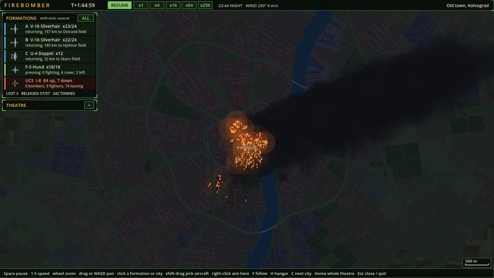
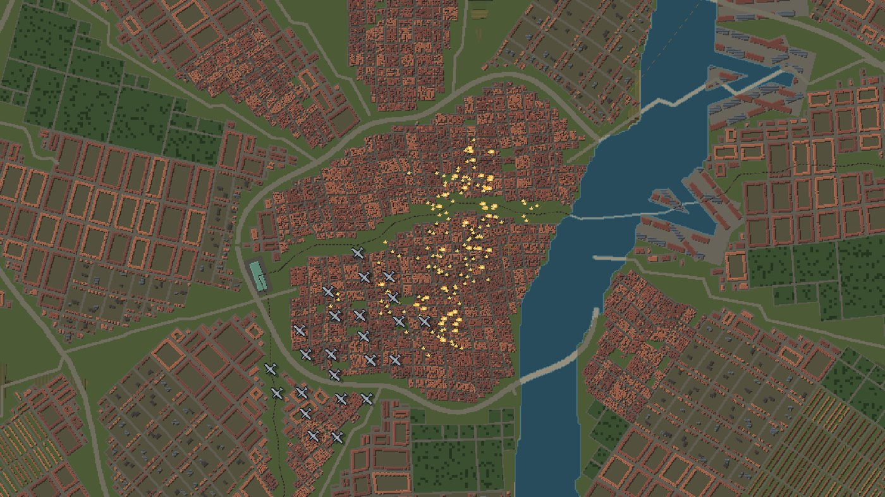
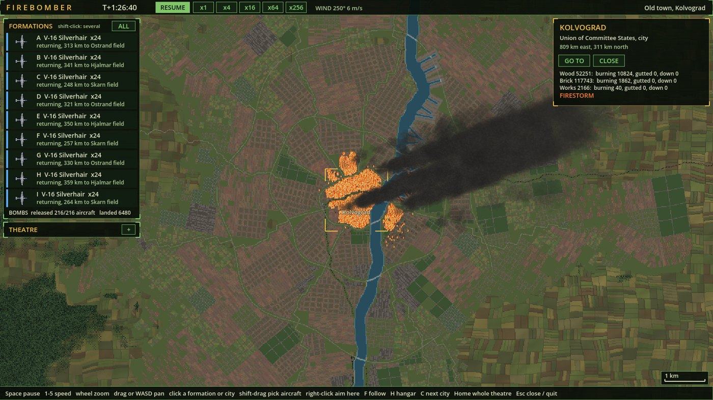
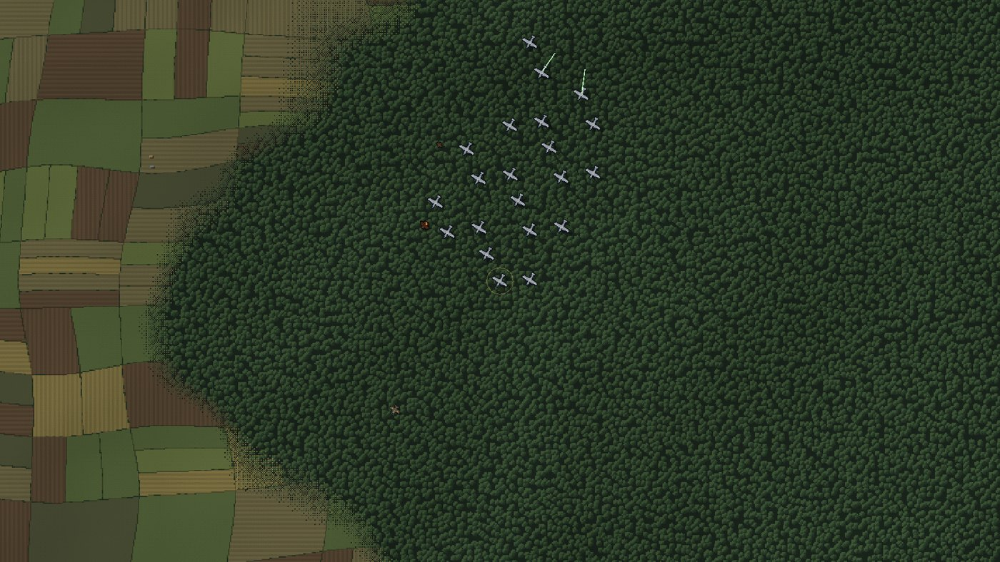
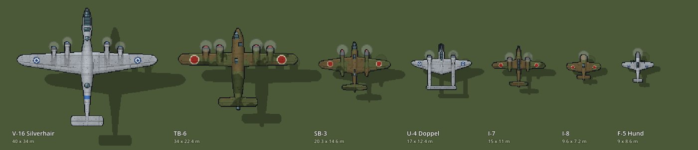
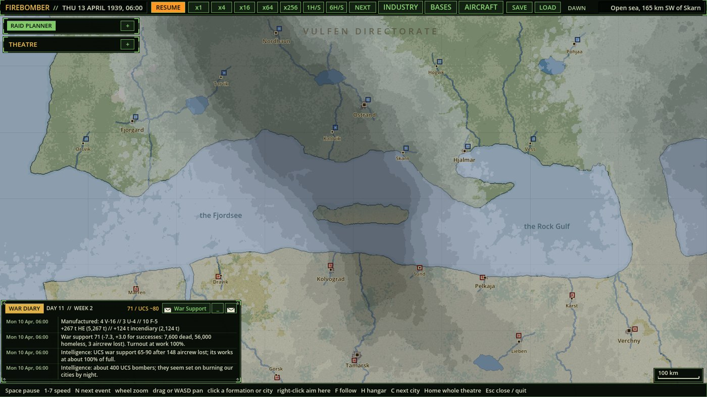
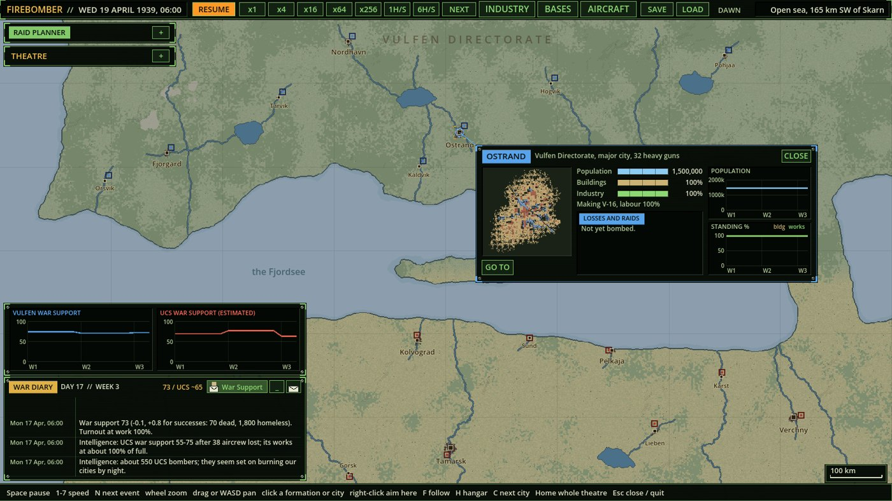
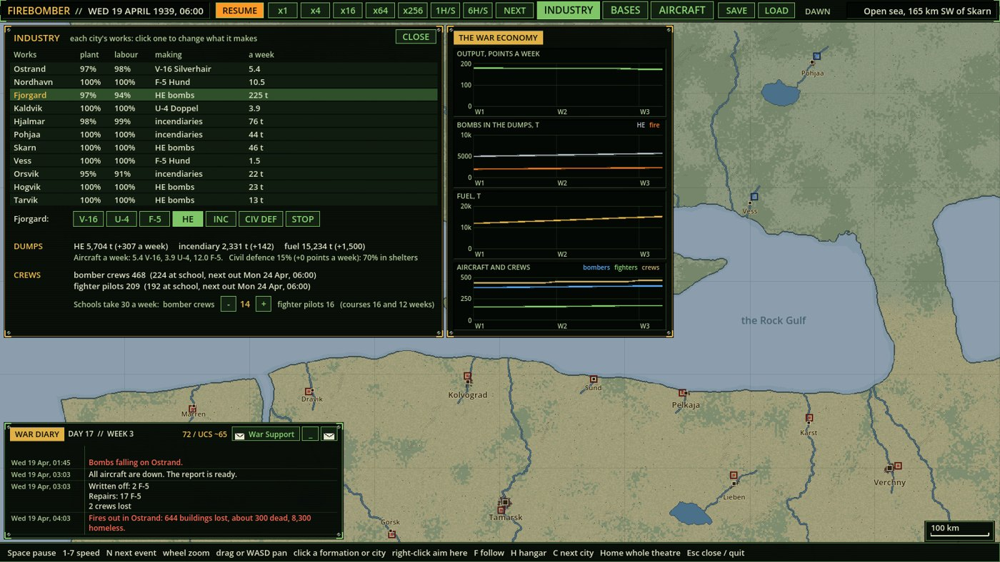

# Firebomber

A top-down strategic bombing game in pixel art. Wolves against deer, one war on one running clock. Plan a raid, fly it, watch what it does to a city, and live with the results for years.



**The Vulfen Directorate** (wolves) has few aircraft, good crews and radar. **The Union of Committee States** (deer) has numbers, and it plans and flies its own raids against you. The war ends when one side's will to fight breaks.

The game is unfinished, but the whole campaign is playable.

## Raids

Choose a target, a time and a load, then fly it. Every aircraft is simulated on its own, with its own crew, fuel, guns and damage.



- **Bombs** fall with real scatter: near-perfect from 1,000 m, spread wide from 6,000 m, and worse in wind, cloud and darkness.
- **Cities are built building by building**, up to hundreds of thousands per city, in wood, brick and works. High explosive blows them down; incendiaries start fires that spread street by street.
- **Firestorms** come when enough burns at once. Fire crews take time to turn out and can be overwhelmed, and a dry gale throws embers across streets.
- **Civilians** are counted. Who dies depends on the hour, the shelters, and what fell on them.



## Fighters and flak

Pilots decide for themselves, and you can click any of them to read why. Squadrons form up and go in together, escorts sweep ahead of the bombers, and flak predicts where a box will be.





## The war

The clock runs fast through quiet days and slows when anything is flying.



- **Weather** moves across the map in fronts, with wind, rain and a moon. It changes who can see whom, how far the bombs stray and how well fire spreads.
- **Airfields and stocks:** every aircraft sits on a field. Ferry them, set patrols, and tell each field how to intercept.
- **Industry:** choose what each city's works builds. Retooling costs weeks. Bombed works and bombed workers build less.
- **Crews** take months to train, and the Vulfen cannot replace them quickly.
- **Everything can be bombed:** runways, parked aircraft, fuel and bomb depots, flak batteries and radar stations.
- **War support** falls with the dead and the homeless, and turnout at the works falls with it.





## Running it

You need [Godot 4.7.2 .NET](https://godotengine.org/download/archive/) and the [.NET 8 SDK](https://dotnet.microsoft.com/download/dotnet/8.0).

```bash
dotnet build FirebomberB2.sln
```

Then open `project.godot` in Godot and press Play, or run the Godot executable from this folder with `--path .`. With no arguments the game starts a new campaign.

Space pauses, 1-7 set the speed, the mouse wheel zooms, and dragging or WASD pans. Click a formation, city or airfield to give orders. H opens the hangar.
